# Pairing GbbDongle with GbbOptimizer

*[Wersja polska](pairing.pl.md)*

Instead of copying the MQTT server, Plant Id and token by hand, you generate a one-time code in GbbOptimizer and paste it into the dongle's web panel. The dongle fetches the installation's settings itself, shows them for confirmation, saves them and connects to the cloud. It takes about a minute.

The screenshots show the panel in Polish; the **EN** button at the top right switches it to English. The English labels are given in the steps.

**Before you start**

- The dongle is on a network with internet access and its panel is open in your browser (see [How do I find the dongle on my network?](faq.md#how-do-i-find-the-dongle-on-my-network)).
- The dongle runs firmware with pairing (a "Pair with GbbOptimizer" card on the **GbbOptimizer cloud** page). Without it, enter the settings by hand as described in the [FAQ](faq.md#what-do-i-configure-in-gbboptimizer).
- You have a GbbOptimizer account with an installation.
- Generating a code gives the installation a **new token**. Anything that uses the old token loses its connection: GbbConnect2, the MQTT bridge in Home Assistant and chart links with the token in the address. If you use them, put the new token there after pairing.

## Part 1: GbbOptimizer

### 1. Set the installation type to "with GbbDongle"

Open **Instalacje** (Plants) and click **Popraw** (Edit) next to your installation. If the Type field already says "with GbbDongle", go to step 2.

Otherwise click **Change type or timeslots…**, pick **Plant with GbbDongle by K.Hajdamowicz** as **New type** and click **Change**. From now on the dongle controls the installation, not GbbConnect2.

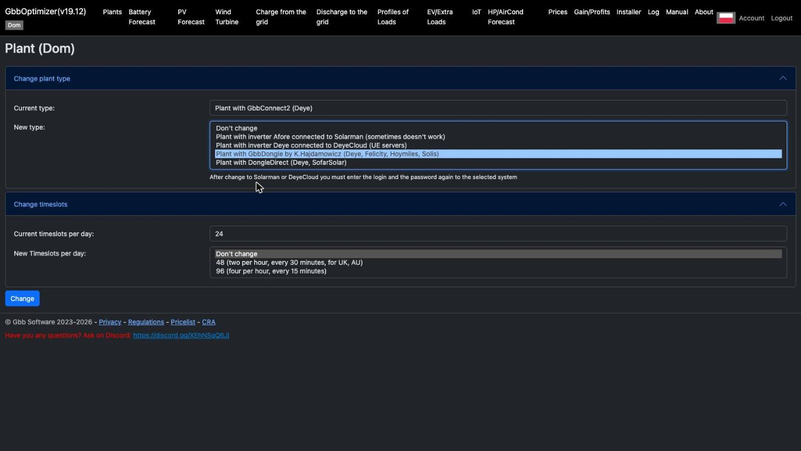

### 2. Generate a pairing code

On the installation page, find the **GbbDongle Pairing** section and click **Generate a new code**. Leave **Also generate a new token (recommended)** ticked.

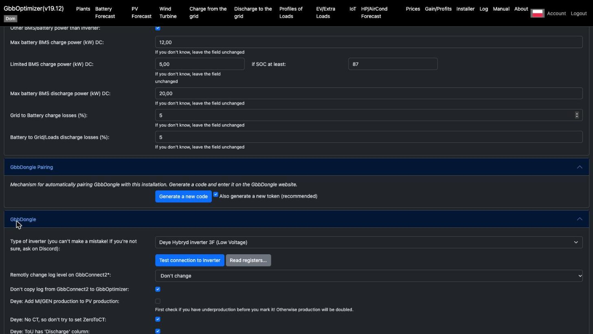

### 3. Copy the code

The code appears in the same section, e.g. `J-EEH7-ABCD` (some accounts have two letters at the start, e.g. `AB-EEH7-ABCD`). It works **once and for 10 minutes**. Don't send it to anyone: whoever uses it gets your installation's token.

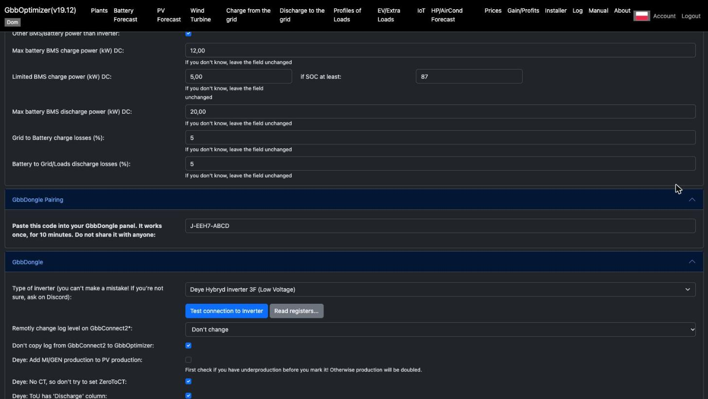

## Part 2: the dongle's panel

### 4. Go to the cloud settings

On the **Overview** page a new dongle shows "Finish the setup". Click **Go to cloud settings**, or pick **GbbOptimizer cloud** in the menu.

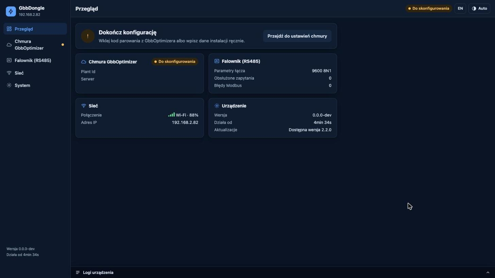

### 5. Find the "Pair with GbbOptimizer" card

It is at the top of the page, above the fields for entering the settings by hand.

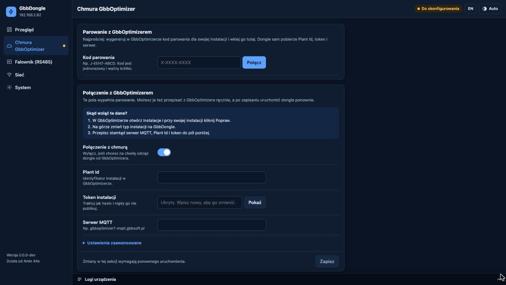

### 6. Paste the code and click "Connect"

Spaces, lower case and missing dashes don't matter: the dongle puts the code into the right form.

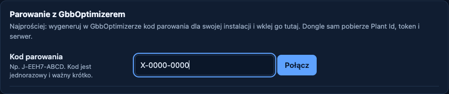

### 7. Wait a few seconds

The dongle contacts GbbOptimizer over HTTPS and fetches the installation's settings. The code field is cleared once the code is sent.

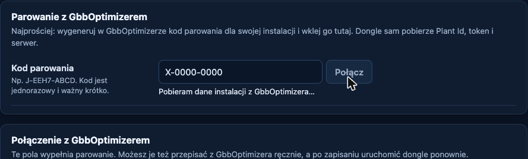

### 8. Check the installation and click "Save and connect"

The panel shows which installation the code belongs to: its name, Plant Id and MQTT server. If they are right, click **Save and connect**. **Cancel** saves nothing. Without a decision the settings are dropped after 10 minutes and you need a new code.

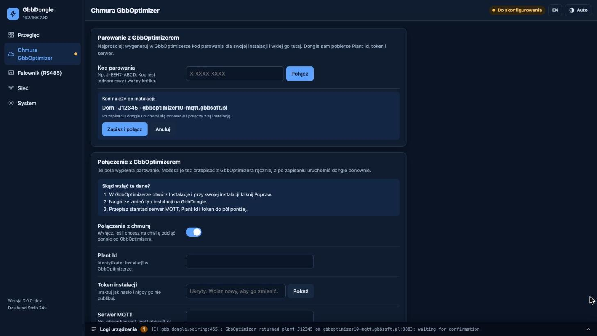

### 9. The dongle restarts

The settings are saved and the dongle restarts (usually a few to a dozen seconds). The page reconnects by itself; there is no need to reload it.

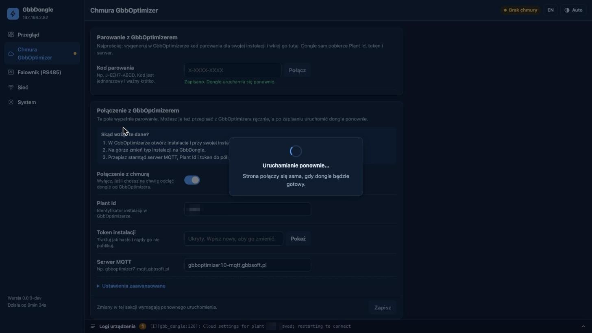

### 10. Done

The **Overview** page shows "Everything works" and a green "Cloud connected". GbbOptimizer can now control the inverter.

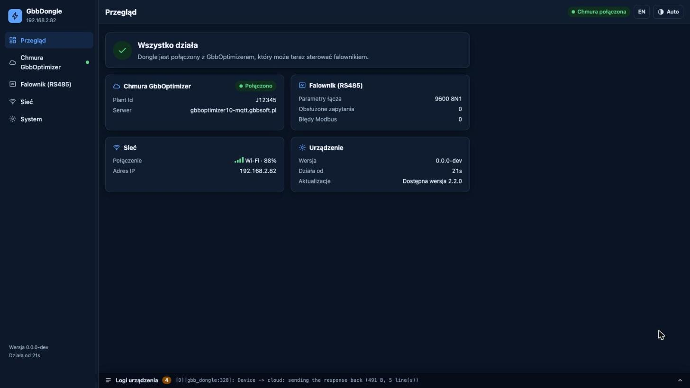

## If something goes wrong

The message appears under the code field.

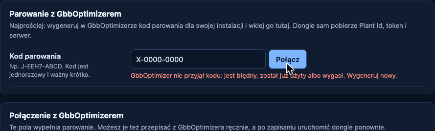

| Message | What to do |
|---|---|
| That doesn't look like a pairing code. | Copy the whole code again. |
| GbbOptimizer didn't accept the code: it is wrong, already used or expired. | Generate a new code (step 2). A code works once and for 10 minutes. |
| Too many attempts. | Wait a few minutes and try again. |
| Couldn't reach GbbOptimizer. | Check that the dongle has internet access (Network page). |
| GbbOptimizer reported an error. | Try again in a few minutes. |
| GbbOptimizer answered in an unexpected way. | The details are in "Device logs" at the bottom of the page; report them on Discord. |
| Nothing was saved within 10 minutes. | Generate a new code and start again from step 2. |

Entering the settings by hand still works: the Plant Id, Plant token and MQTT server fields are below the pairing card.
