# Parowanie GbbDongle z GbbOptimizerem

*[English version](pairing.md)*

Zamiast przepisywać ręcznie serwer MQTT, Plant Id i token, generujesz w GbbOptimizerze jednorazowy kod i wklejasz go w panelu dongla. Dongle sam pobiera dane instalacji, pokazuje je do potwierdzenia, zapisuje i łączy się z chmurą. Całość zajmuje około minuty.

**Zanim zaczniesz**

- Dongle jest podłączony do sieci z dostępem do internetu, a jego panel masz otwarty w przeglądarce (zobacz [Jak znaleźć dongle w sieci?](faq.pl.md#jak-znaleźć-dongle-w-sieci)).
- Dongle ma firmware z parowaniem (karta „Parowanie z GbbOptimizerem” na stronie **Chmura GbbOptimizer**). Bez niej wpisz dane ręcznie, jak w [FAQ](faq.pl.md#co-ustawić-w-gbboptimizerze).
- Masz konto w GbbOptimizerze i założoną instalację.
- Wygenerowanie kodu nadaje instalacji **nowy token**. Wszystko, co korzysta ze starego tokenu, straci połączenie: GbbConnect2, most MQTT w Home Assistant i linki do wykresów z tokenem w adresie. Jeśli z nich korzystasz, po parowaniu wpisz tam nowy token.

## Część 1: GbbOptimizer

### 1. Ustaw typ instalacji „with GbbDongle”

Otwórz **Instalacje** (Plants) i przy swojej instalacji kliknij **Popraw** (Edit). Jeśli w polu Typ jest już „with GbbDongle”, przejdź do kroku 2.

Inaczej kliknij **Change type or timeslots…**, w polu **New type** wybierz **Plant with GbbDongle by K.Hajdamowicz** i kliknij **Change**. Od tej chwili instalacją steruje dongle, a nie GbbConnect2.

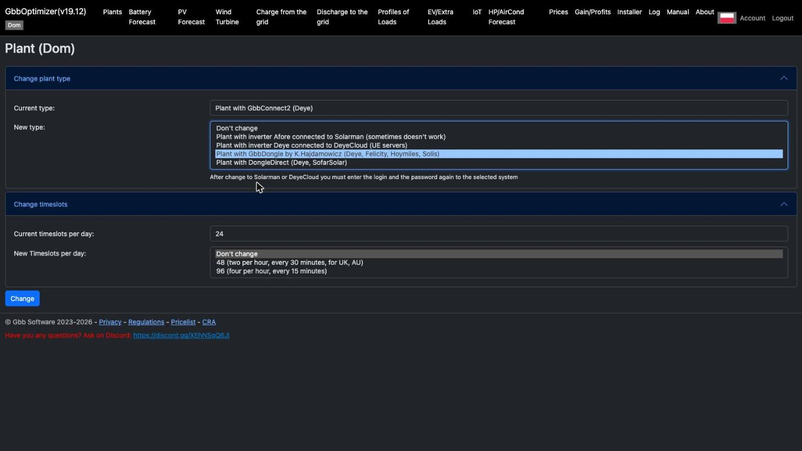

### 2. Wygeneruj kod parowania

Na stronie instalacji znajdź sekcję **GbbDongle Pairing** i kliknij **Generate a new code**. Pole **Also generate a new token (recommended)** zostaw zaznaczone.

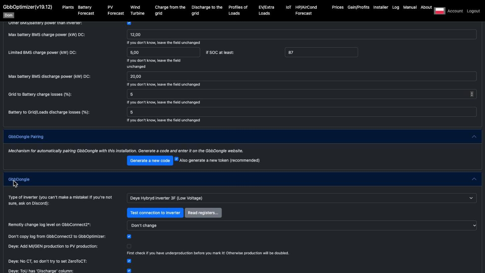

### 3. Skopiuj kod

Kod pojawi się w tej samej sekcji, np. `J-EEH7-ABCD` (niektóre konta mają na początku dwie litery, np. `AB-EEH7-ABCD`). Kod działa **raz i przez 10 minut**. Nie wysyłaj go nikomu: kto go użyje, dostanie token Twojej instalacji.

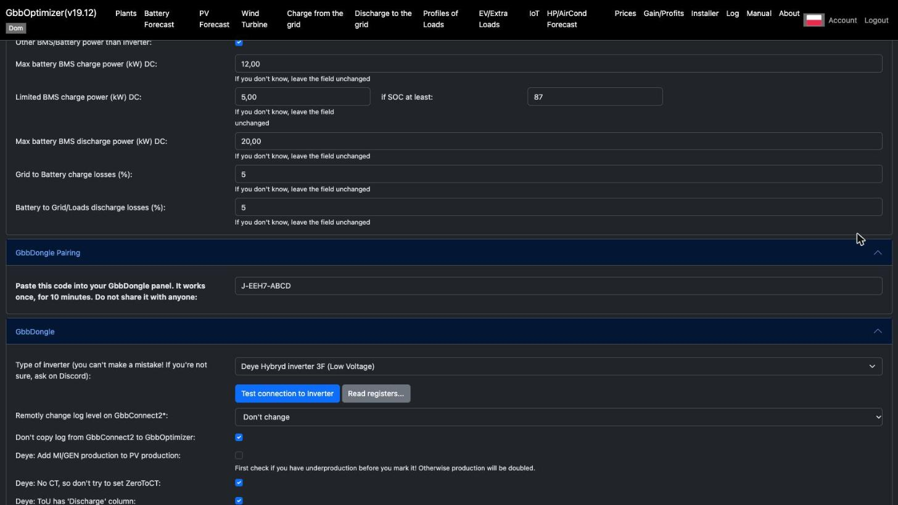

## Część 2: panel dongla

### 4. Przejdź do ustawień chmury

Na stronie **Przegląd** nowy dongle pokazuje „Dokończ konfigurację”. Kliknij **Przejdź do ustawień chmury** albo wybierz z menu **Chmura GbbOptimizer**.

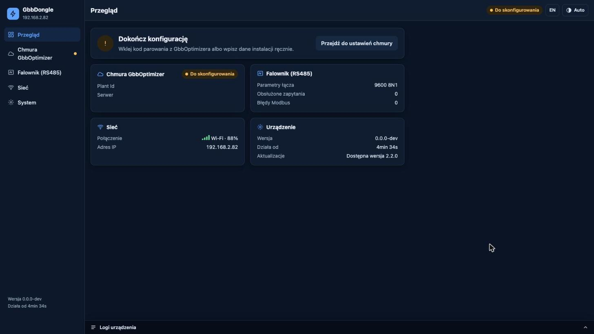

### 5. Znajdź kartę „Parowanie z GbbOptimizerem”

Jest na górze strony, nad polami do ręcznego wpisania danych.

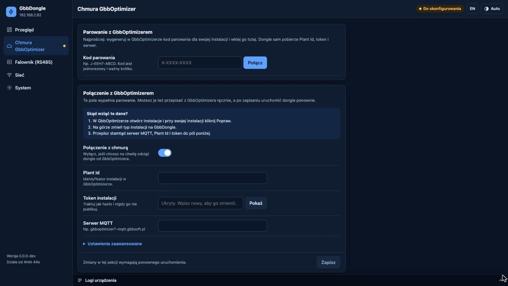

### 6. Wklej kod i kliknij „Połącz”

Spacje, małe litery i brak myślników nie przeszkadzają: dongle sam doprowadzi kod do właściwej postaci.

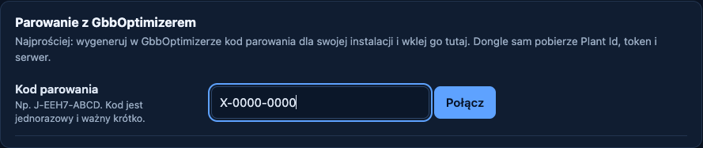

### 7. Poczekaj kilka sekund

Dongle łączy się z GbbOptimizerem po HTTPS i pobiera dane instalacji. Pole kodu czyści się po wysłaniu.

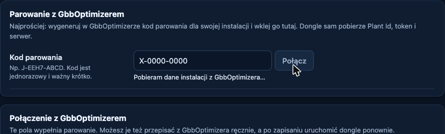

### 8. Sprawdź instalację i kliknij „Zapisz i połącz”

Panel pokazuje, do jakiej instalacji należy kod: nazwę, Plant Id i serwer MQTT. Jeśli się zgadzają, kliknij **Zapisz i połącz**. **Anuluj** niczego nie zapisuje. Bez decyzji dane przepadają po 10 minutach i trzeba wygenerować nowy kod.

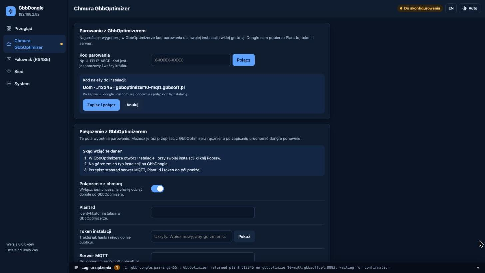

### 9. Dongle uruchamia się ponownie

Ustawienia są zapisane, dongle restartuje się (zwykle kilka do kilkunastu sekund). Strona sama połączy się ponownie, nie trzeba jej odświeżać.

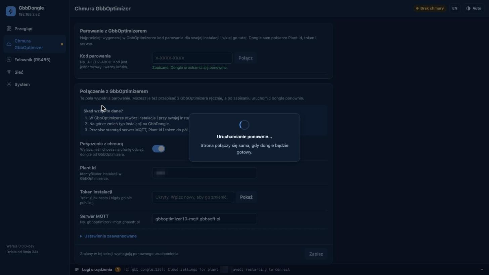

### 10. Gotowe

Na stronie **Przegląd** widać „Wszystko działa” i zielone „Chmura połączona”. GbbOptimizer może teraz sterować falownikiem.

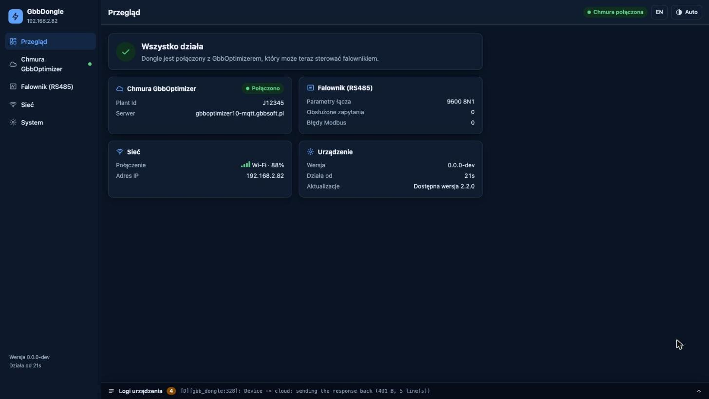

## Gdy coś pójdzie nie tak

Komunikat pojawia się pod polem kodu.

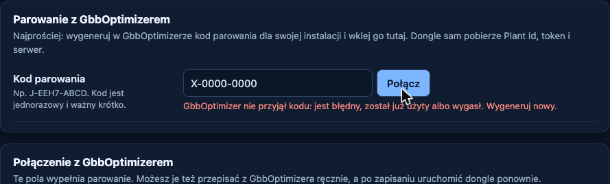

| Komunikat | Co zrobić |
|---|---|
| To nie wygląda na kod parowania. | Skopiuj kod jeszcze raz w całości. |
| GbbOptimizer nie przyjął kodu: jest błędny, został już użyty albo wygasł. | Wygeneruj nowy kod (krok 2). Kod działa raz i przez 10 minut. |
| Za dużo prób. | Odczekaj kilka minut i spróbuj ponownie. |
| Nie udało się połączyć z GbbOptimizerem. | Sprawdź, czy dongle ma internet (strona Sieć). |
| GbbOptimizer zgłosił błąd. | Spróbuj ponownie za kilka minut. |
| GbbOptimizer odpowiedział w nieoczekiwany sposób. | Szczegóły są w „Logi urządzenia” na dole strony; zgłoś je na Discordzie. |
| Dane nie zostały zapisane w ciągu 10 minut. | Wygeneruj nowy kod i powtórz od kroku 2. |

Ręczne wpisanie danych nadal działa: pola Plant Id, Token instalacji i Serwer MQTT są pod kartą parowania.
